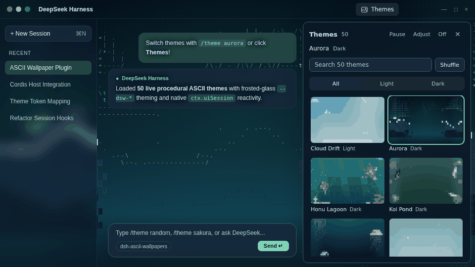
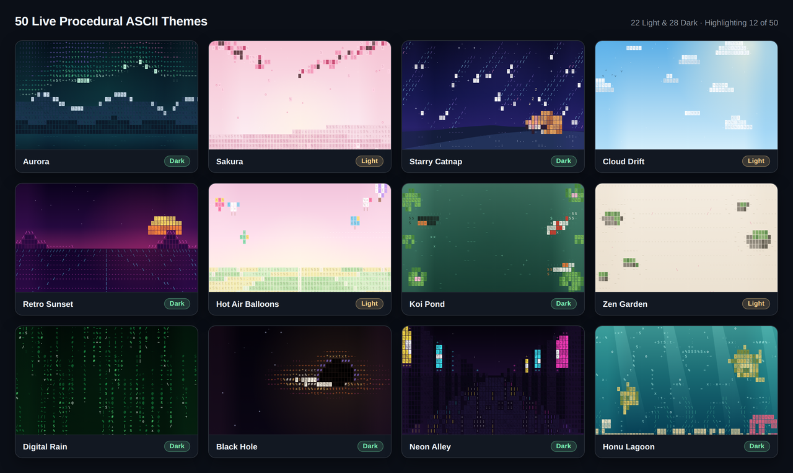

# ASCII Wallpapers for DeepSeek Harness

> Ported from **[Mix4o445/antigravity-ascii-wallpapers](https://github.com/Mix4o445/antigravity-ascii-wallpapers)** ([Live Demo & Theme Showcase](https://mix4o445.github.io/antigravity-ascii-wallpapers/)) and adapted as a **native Cordis client/host plugin** (`dsh-ascii-wallpapers`) for the **DeepSeek Harness** desktop app.

> Unofficial community plugin. Not affiliated with or endorsed by DeepSeek AI or Google. Nothing leaves your machine.

Unlike an `app.asar` patcher, this plugin registers cleanly in your DeepSeek Harness user patch file (`cordis.patch.yml`), **does not modify `app.asar`**, and survives app updates.

## Preview



*Live animated ASCII wallpapers (`Aurora`, `Sakura`, `Starry Catnap`) with automatic frosted-glass `--dsw-*` UI theming and the built-in Shadow DOM theme picker.*

### Theme Showcase (12 of 50)



*22 light and 28 dark procedural Canvas 2D scenes — try all 50 interactively in the [Live Demo & Theme Showcase](https://mix4o445.github.io/antigravity-ascii-wallpapers/).*

## Features

- **50 live themes** (22 light and 28 dark): Cloud Drift, Aurora, Honu Lagoon, Koi Pond, Jellyfish, Paper Boats, Sakura, Fireflies, Moonlit, Ember Dunes, Night Rain, Snowfall, Sky Lanterns, Windy Meadow, Spiral Galaxy, Bamboo Grove, Digital Rain, Morning Tide, Autumn Leaves, Alpine Dawn, Retro Sunset, Lava Lamp, Starry Catnap, Supercell, Black Smokers, Candlelight, Neon Alley, Black Hole, Volcano, Swirling Night, Radar Scope, Ice Giant, Kelp Forest, Signal Glitch, Peacock Feathers, Blueprint, Stained Glass, Ink Wash, Ice Cave, Hot Air Balloons, Coral Reef, Pop Art, Paper Cranes, Matcha, Desert Oasis, Lavender Fields, Windmills, Island Palms, Moire, and Zen Garden.
- **Native `ctx.theme` integration**: Registers dynamic `--dsw-*` token themes (`--dsw-alias-*` and `--dsw-specific-*`, including `--dsw-specific-sidebar-fill` for Windows titlebar synchronization) while preserving your saved Light/Dark/System preference, plus frosted-glass surfaces for the sidebar, composer, and menus.
- **Native agent reactivity (`ctx.uiSession`)**: Subscribes to `ctx.uiSession.sessionStatus` to speed up and brighten animations while sessions are running, and triggers a completion ripple when a run finishes.
- **Three ways to open or switch**: Click **Themes** in the top right, press **Ctrl+Alt+W** (**⌥⌘W** on macOS), or type `/theme` in the composer (e.g. `/theme catnap`, `/theme random`, `/theme off`).
- **Controls**: Pause/Play, Intensity slider (15%–100%), Glyph style (`ASCII`, `Braille`, `Blocks`, `Katakana`), Grid density (`Fine`, `Normal`, `Chunky`), **Theme app** toggle, **React to agents** toggle, Search, Light/Dark filter, Shuffle, and **Off** to restore the stock appearance.
- **100% local**: Preferences stay in your browser's local storage (`dshAsciiWallpaperPreferences.v1`). Rendering pauses automatically when the window is hidden or `prefers-reduced-motion` is enabled.

## Requirements

- DeepSeek Harness Desktop installed (tested against `@deepseek-ai/dsh-desktop` `0.2.2-rc.5`)
- [Node.js](https://nodejs.org) 18 or newer

## Install

1. Clone this repository (or download and extract the ZIP):
   ```bash
   git clone https://github.com/Davidzinco/deepseek-harness-ascii-wallpapers.git
   cd deepseek-harness-ascii-wallpapers
   ```
2. *(Optional)* Verify the plugin build and check status without changing any files:
   ```bash
   node manage-wallpapers.cjs verify
   node manage-wallpapers.cjs status
   ```
3. Install the plugin into your DeepSeek Harness desktop profile (`~/.dsh/profiles/desktop/cordis.patch.yml`):
   ```bash
   node manage-wallpapers.cjs install
   ```
4. Open or restart **DeepSeek Harness** and click **Themes** (or press **Ctrl+Alt+W** / type `/theme`).

## Uninstall

To remove the plugin entry while preserving all your other DeepSeek Harness plugins and settings:

```bash
node manage-wallpapers.cjs uninstall
```

`restore` works as an alias for `uninstall`. Only the `# ascii-wallpapers:start ... # ascii-wallpapers:end` block is removed, and a backup of your original `cordis.patch.yml` is kept as `cordis.patch.yml.ascii-wallpapers.backup`.

## Development & Verification

Build the client bundle from source (`src/wallpaper-scenes.js` + `src/dsh-ascii-wallpapers.js` → `lib/client.js`) and run the test suite:

```bash
node scripts/build-client.cjs
node tests/plugin.test.cjs
node manage-wallpapers.cjs verify
```

## How It Works

DeepSeek Harness's `@deepseek-ai/dsh-client-modules` discovers host plugins loaded via `cordis.patch.yml` by reading `package.json`'s `dsh.client` declaration and `exports["./client"]`, then loads `lib/client.js` through `window.__ModuleLoader__`.

| File | Purpose |
|---|---|
| `src/wallpaper-scenes.js` | 50 procedural Canvas 2D ASCII scene renderers (`drawAsciiScene`) |
| `src/dsh-ascii-wallpapers.js` | DeepSeek Harness client runtime (Shadow DOM picker, `ctx.theme` + `--dsw-*` theming, `ctx.uiSession` reactivity) |
| `lib/index.js` | Minimal Cordis host plugin entrypoint |
| `lib/client.js` | Built `window.__ModuleLoader__` browser bundle (generated by `scripts/build-client.cjs`) |
| `scripts/build-client.cjs` | Zero-dependency bundler and syntax verifier |
| `manage-wallpapers.cjs` | Safe CLI to `verify`, `status`, `install`, and `uninstall` the plugin entry in `cordis.patch.yml` |

## Credits / Original Source

- **Original project**: [antigravity-ascii-wallpapers](https://github.com/Mix4o445/antigravity-ascii-wallpapers) by **[Mix4o445](https://github.com/Mix4o445)** ([Demo & Themes](https://mix4o445.github.io/antigravity-ascii-wallpapers/)).
- The 50 procedural ASCII scene renderers (`src/wallpaper-scenes.js`), theme palettes, and picker UI design originate from `Mix4o445/antigravity-ascii-wallpapers` under the MIT License.
- This repository adapts the runtime, `--dsw-*` theming, session reactivity, and Cordis plugin packaging for **DeepSeek Harness**.

## License

MIT. See [LICENSE](LICENSE).
